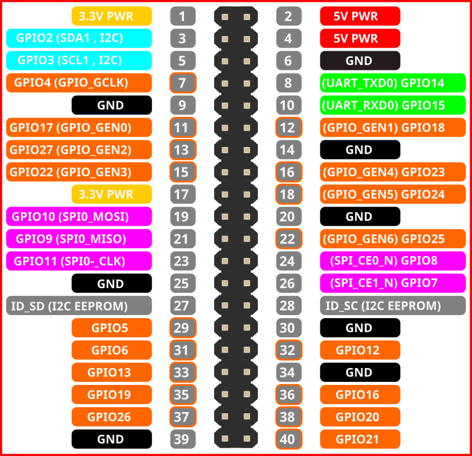

# SGP

super green project


### Utilisation

Apres avoir récupérer le projet sur  
`git clone https://github/kwabounga/sgp`

naviguer dans le dossier *./sgp/*  
et taper:  

d'une part  
`npm run server`
// pour démarrer le serveur sur le raspberry  

et d'autre part  
`npm start` // pour ouvrir le module de monitoring sur un pc

`//TODO: utilisation de npm link pour créer une CLI`
```sh
$ sgp start [-s scenario (default='default')]
$ sgp reboot
$ sgp stop
$ sgp load
$ sgp infos ??
```

utile:
```js
const exec = require('child_process').exec, child;
const myShellScript = exec('sh doSomething.sh /myDir');
myShellScript.stdout.on('data', (data)=>{
    console.log(data);
    // do whatever you want here with data
});
myShellScript.stderr.on('data', (data)=>{
    console.error(data);
});
```
### BDD
l'application utilise une base de donnée mySql pour  
* récupérer la configuration des scenarios
* et enregistrer les relevés
* et les photos

### Modules
Description des modules et utilisation / personnalisation

#### configuration.js

configuration loader/parser  
usage :

*créer le fichier ***./conf/.conf*** avec les infos suivantes:*
```conf
rest_url:localhost
rest_port:4000
db_url:localhost
db_port:3306
db_name:db_name
db_user:username
db_pwd:password
```

*Charger la configuration:*
```js
require('./exports/configuration.js').configuration('./conf/.conf', (conf) => {
  // callBack with configuration object data
  /*
  conf :
  {
    rest_url: 'localhost',
    rest_port: '4000',
    db_url: 'localhost',
    db_port: '3306',
    db_name: 'db_name',
    db_user: 'username',
    db_pwd: 'password'
  }
  */
});
```

#### rest.js

le serveur de l'api rest

1. permet de questionner le serveur sur les actions possible à effectuer
1. permet de questionner le serveur, et de recupérer des relevés sur les capteurs  
1. permet d'effectuer des tâches simples à distance via l'application 'back office'

**les infos a recuperer:**
* temperature
* acidité
* humidité
* motitoring global
* photos

**les tâches à effectuer:**
* envoyer/couper l'eau
* allumer/couper la ventilation
* prendre une photo
* allumer / couper la lumière
* ...

#### session.js

créer un code de securité pour pouvoir executer des commandes spécifiques via API REST  

```js
let code = require('./session.js');
code.getCode(); // renvoi le code
```


#### connection.js

connection à la base de donnée  
renvoi une connection prête à executer des queries

```js
  let con = require('./connection.js').connection(conf);

  con.query('SELECT * FROM TABLE',(err,results, fields)=>{}))
  con.query('SELECT * FROM TABLE where age =? AND color=?',[21,'blue'],(err,results, fields)=>{})
```

#### sgp_machines.js

Acces aux differents capteurs du Raspberry  
`// TODO: voir pour le renommer en 'sgp_sensors'`

```js
var sgp_machines = require('./sgp_machines.js');

sgp_machines.temperature() // renvoi la temperature
sgp_machines.acidity() // renvoi le ph de l'eau
sgp_machines.humidity() // renvoi l'humidité de l'air
sgp_machines.water_level() // renvoi le niveau d'eau
```


#### sgp_monitoring.js

Moteur du Serveur  
s'occupe d'effectuer des relevés regulièrement et effectuer des tâches en conséquence  
Les tâches sont paramétrées dans la base de données dans la table 'scenarios'

utilisation:

```js
// on récupere l'objet Monitoring
var Monitoring = require('./exports/sgp_monitoring');
// instanciation de l'objet en lui passant le nom du scenario, et la configuration en parametres
let mon = new Monitoring('default',conf);

// initialisation du monitoring
mon.init(() => {
  // une fois connecté et configuré
  // on est pret a lui faire faire des tâches
  mon.overview(); // apercus de la configuration (scenario)
  mon.start(); // Démarrage du Monitoring
  mon.summary(); // renvoi préleve les infos sur tous les capteurs et renvoi le resultat
});
```
`// TODO: faire une methode pour stopper le Monitoring`  


## Raspberry spécificités

#### GPIO

#### Beadboard

