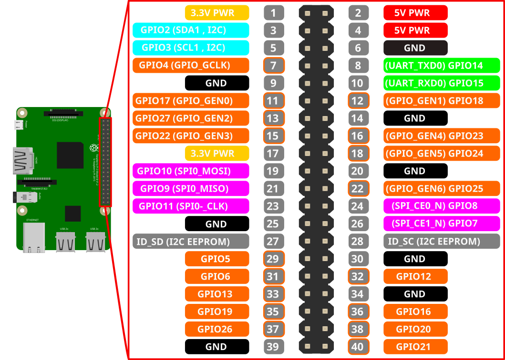

  


# ***Super Green Project***


*ou projet* ***super green***  

système de gestion et controle de culture inDoor automatisé  
à terme:  
software  
* Dashboard / Overview client en local avec electron
* Serveur de controles, relevés avec scénarios
* API rest pour l'interface serveur / client  
* BDD pour l'historique des relevés et overview
hardware  
* Machine de controle ( rpi, sensors, caméra, et controleurs d'alimentation eau / électricité)
* systeme hydro

## Prérequis
Pour utiliser le systeme il vous faudra  

Coté hardware  
* rpi Modele 3
* capteur humidité / temprérature dht11
* quelques led
* capteur de niveau d'eau
* capteur acidité
* lister les autres capteurs ...
* switch/ controleur alimentation x3
* switch / debit d'eau / valve x2

Coté software  
*sur le rpi*

* node ^10.0.0 et npm
* mariadb

*sur l'ordinateur de controle*
* node ^10.0.0 et npm

Pour les tests sgp_srv reconnait l'environnement et peut aller se connecter a une base de donnée mysql et va simuler les relever au lieu d'interroger les capteurs  

### Utilisation  
Apres avoir finit de faire le montage du systeme  
Récupérer le projet sur git  
*sur le RPI*
```sh
git clone https://github/kwabounga/sgp
```
* installer mariadb
* entrez les infos de configuration ip pwd ect

naviguer dans le dossier *./sgp/*  
créer un fichier ./conf/.conf
et taper:  

```sh
npm install
npm run server
# pour démarrer le serveur sur le raspberry  
```
*sur le PC local*
```sh
git clone https://github/kwabounga/sgp
```
* installer mysql pour les test sinon pas la peine
* entrez les infos de configuration ip pwd ect

naviguer dans le dossier *./sgp/*  
créer un fichier ./conf/.conf

```sh
npm install
npm start
# ouvre le module de monitoring sur un pc (app electron)
```  

Ajout de la commande
```sh
npm run all
# lance srv et monitoring (pour tests en local)
```

Creation de la commande 'sgp'

```sh
# installation
$ cd ..../sgp/
$ npm link
> done
```
A partir de là si un access en ssh vers le rpi est configuré
un monitoring en ligne de commande est possible

```sh
$ sgp -V
# numero de version
$ sgp -h
# affiche l'aide
$ sgp -h -c [pwd]
# affiche l'aide et la configuration
$ sgp -m [pwd]
# affiche le monitoring en ligne de commandes
```


# partie technique

## TODO utile:  
pour la creation post-instal de la dbb directement??
```js
  const exec = require('child_process').exec, child;
  const myShellScript = exec('sh doSomething.sh /myDir');
  myShellScript.stdout.on('data', (data)=>{
      console.log(data);
      // do whatever you want here with data
      // inclure mariadb  
      // création de la bdd avec scénario de base
  });
  myShellScript.stderr.on('data', (data)=>{
      console.error(data);
  });
```
### BDD
l'application utilise une base de donnée mySql (local) / mariadb (rpi) pour  
* récupérer la configuration des scenarios
* enregistrer les relevés
* enregistrer les liens/id/informations? des photos

## Modules
Description des modules et utilisation / personnalisation
intégration du dashboard pour le monitoring cli

### Server
#### configuration.js

outils perso pour la recuperation et l'instanciation de la configuration
usage :

*créer le fichier ***./conf/.conf*** avec les bonnes infos:*
```conf
rest_url:localhost
rest_port:4000
db_url:localhost
db_port:3306
db_name:db_name
db_user:username
db_pwd:password

log_file:./log/sgp-logs.log
err_file:./log/sgp-exceptions.log

admin_pass:admin
```

*Charger la configuration:*
```js
require('./exports/configuration.js').configuration('./conf/.conf', (conf) => {
  // callBack with configuration object data
  /*
  conf :
  {
    rest_url: 'localhost',
    rest_port: '4000',
    db_url: 'localhost',
    db_port: '3306',
    db_name: 'db_name',
    db_user: 'username',
    db_pwd: 'password'
  }
  */
});
```

#### rest.js

le serveur à une api rest

1. permet de questionner le serveur sur les actions possible à effectuer
1. permet de questionner le serveur, et de recupérer des relevés sur les capteurs  
1. permet d'effectuer des tâches simples à distance via l'application 'back office'

**les infos a recuperer:**
* temperature
* acidité
* humidité
* motitoring global
* photos

**les tâches à effectuer:**
* envoyer/couper l'eau
* allumer/couper la ventilation
* prendre une photo
* allumer / couper la lumière
* ...

#### session.js

créer un code de securité pour pouvoir executer des commandes spécifiques via API REST  

```js
let code = require('./session.js');
code.getCode(); // renvoi le code
```


#### connection.js

connection à la base de donnée  
renvoi une connection prête à executer des queries

```js
  let con = require('./connection.js').connection(conf);

  con.query('SELECT * FROM TABLE',(err,results, fields)=>{}))
  con.query('SELECT * FROM TABLE where age =? AND color=?',[21,'blue'],(err,results, fields)=>{})
```

#### sgp_machines.js

Acces aux différents capteurs du Raspberry  
`// TODO: voir pour le renommer en 'sgp_sensors'`

```js
var sgp_machines = require('./dal/sgp_machines.js');

sgp_machines.temperature(); // renvoi la temperature
sgp_machines.acidity(); // renvoi le ph de l'eau
sgp_machines.humidity(); // renvoi l'humidité de l'air
sgp_machines.water_level(); // renvoi le niveau d'eau
sgp_machines.luminosity(); // renvoi l'état des lumieres
```


#### sgp_monitoring.js

Moteur du Serveur  
s'occupe d'effectuer des relevés regulièrement et effectuer des tâches en conséquence  
Les tâches sont paramétrées dans la base de données dans la table 'scenarios'

utilisation:

```js
// on récupere l'objet Monitoring
var Monitoring = require('./exports/bll/sgp_monitoring');
// instanciation de l'objet en lui passant le nom du scenario, et la configuration en parametres
let mon = new Monitoring('default',conf);

// initialisation du monitoring
mon.init(() => {
  // une fois connecté et configuré
  // on est pret a lui faire faire des tâches
  mon.overview(); // apercus de la configuration (scenario)
  mon.start(); // Démarrage du Monitoring
  mon.summary(); // renvoi préleve les infos sur tous les capteurs et renvoi le resultat
});
```
// TODO: faire une méthode pour stopper le Monitoring  

// exécuter un script qui va lancer / couper un service via la CLI
// exemple: `sgp run ssgp` /  `sgp stop ssgp`
// vérifier l'état d'un service ?  
// exemple: `sgp state ssgp`
// >> running / stopped

## How do I run a node.js app as a background service?

Make a myapp.service file (replacing 'myapp' with your app's name, obviously):  
```
[Unit]
Description=SGP

[Service]
ExecStart=/pi/home/sgp/sgp_srv.js
Restart=always
User=nogroup
# Note Debian/Ubuntu uses 'nogroup', RHEL/Fedora uses 'nobody'
Group=nogroup
Environment=PATH=/usr/bin:/usr/local/bin
Environment=NODE_ENV=production
WorkingDirectory=/var/www/sgp

[Install]
WantedBy=multi-user.target
```

 **Note if you're new to Unix: ``/var/www/myapp/app.js`` should have ``#!/usr/bin/env node`` on the very first line**.

Copy your service file into the `/etc/systemd/system`.

Start it with `systemctl start myapp`.

Enable it to run on boot with `systemctl enable myapp`.

See logs with `journalctl -u myapp`.

### CLI  

utilisation de cli_dashboard pour afficher les données  
image-ascii pour générer les graphiques en code ascii  
Avec *sgp* en ssh on a acces directement au rpi et aux differents capteurs pour les interroger directement  

### Client
  

utilisation de chart.js pour générer les graphique
bootstrap 4 pour le front
requetes sur l'api rest (local) pour récupérer les informations  

## Raspberry spécificités  

#### GPIO


#### RPI

#### Beadboard


#### details du pack de capteurs  

Ensemble de 37 capteurs prêts à être connectés à un microcontrôleur,  
Par exemple pour Arduino ou raspberry berrypi.  
Un excellent paquet pour les expériences Arduino ou comme base pour un projet plus vaste.  
Remarque: cet article est livré sans boîte de composants de protection handyy.  
Emballage inclus:  
1 x petite sonnerie passive module KY-006  
-1 x module LED 2 couleurs KY-011  
-1 x module de capteur Hit KY-031  
-1 x module de commutateur de Vibration KY-002  
-1 x module de résistance Photo KY-018  
-1 x commutateur à clé module KY-004  
-1 x module de commutateur d'inclinaison KY-020  
-1 x modules SMD LED couleur 3 couleurs KY-009  
-1 x module de capteur d'émission infrarouge KY-005  
-1 x module LED 3 couleurs KY-016  
-1 x Mercury ouvert module optique KY-017  
-1 x module LED Yin Yi 2 couleurs 3 MM KY-029  
-1 x module de sonnerie actif KY-012  
-1 x module de capteur de température KY-013  
-1 x clignotant automatique coloré module LED KY-034  
-1 x Mini modules à roseaux magnétiques KY-021  
-1 x Hall capteur magnétique module KY-003  
-1 x capteur infrarouge récepteur module KY-022  
-1 x classe Bihor capteur magnétique KY-035  
-1 x module de tasse de lumière magique KY-027  
-1 x module d'encodeur rotatif KY-040  
-1 x module optique cassé KY-010  
-1 x détecte la KY-039 du module de rythme cardiaque  
-1 x module Reed KY-025  
-1 x module de capteur d'évitement d'obstacles KY-032  
-1 x capteur de chasse module KY-033  
-1 x module de capteur de son Microphone KY-038  
-1 x capteur Laser module KY-008  
-1x5 V relais module KY-019  
-1 x module de capteur de température KY-001  
-1 x module de capteur de température KY-028  
-1 x capteurs linéaires magnétiques Hall KY-024  
-1 x module de capteur de flamme KY-026  
-1 x module de capteur de microphone sensible KY-037  
-1 x module de capteur de température et d'humidité KY-015  
-1 module de joystick xxy-axis KY-023  
-1 x module de capteur tactile en métal KY-036  
